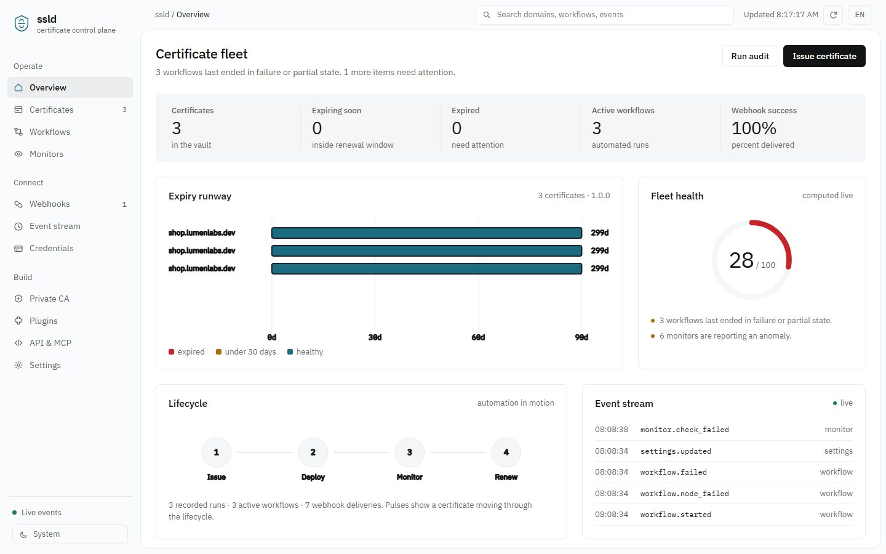
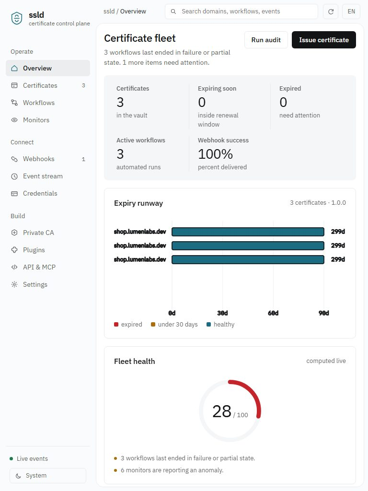
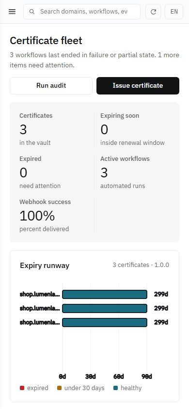

# ssld

**An SSL certificate lifecycle control plane: a complete Rust rewrite of allinssl.**

Repository: <https://github.com/liudonghua123/ssld> · [中文](README.md) · [MIT](LICENSE)

ssld reimplements every business domain found in allinssl: ACME issuance, DNS-01, the certificate vault, credentials and EAB, ACME accounts, notification channels, workflow orchestration, deploy targets, monitoring, private CA, plugins, settings and overview audits. On top of that it adds three things the original did not offer: a complete open REST API, a high-level coarse-grained MCP server for AI assistants, and a fully configurable webhook event system.

By design, **allinssl's CLI service-control surface is excluded** (numbered menus, service start/stop/restart, port and password changes, secure-entry setup, uninstall/update). Configuration lives in a JSON file, environment variables, or the settings API. Stop the process with your process manager (systemd / Docker / Supervisor).

| Metric | Value |
| --- | --- |
| REST endpoints | 103 |
| Coarse-grained MCP tools | 15 |
| Compatible allinssl `/v1/{group}/{action}` actions | 71 |
| DNS providers / host credentials / deploy targets | 25 / 18 / 32 |
| CAs / key algorithms / notification channels / event types | 9 / 6 / 5 / 44 |
| Workflow node types / export formats | 12 / 5 |
| Stack | Rust 2021, no external database at runtime |



<details>
<summary>Tablet and phone views</summary>




</details>

---

## Quick start

```bash
git clone https://github.com/liudonghua123/ssld.git
cd ssld
cargo build --release
./target/release/ssld        # Windows: target\release\ssld.exe
```

Requires Rust stable (edition 2021). The first build compiles all dependencies.

Listens on `0.0.0.0:7979` by default and prints:

```
  Console   http://0.0.0.0:7979/
  REST API  http://0.0.0.0:7979/api/v1/health   (103 endpoints)
  MCP       http://0.0.0.0:7979/mcp            (15 coarse tools)
  Events    http://0.0.0.0:7979/api/v1/events/stream
  State     data/state.json
```

Local mode works out of the box: with no `SSLD_API_KEY` and no `SSLD_AUTH_REQUIRED`, the console and REST API are unauthenticated. **Before exposing it to a network, set `SSLD_API_KEY` or `SSLD_AUTH_REQUIRED=1`.**

```bash
# Production example
SSLD_API_KEY='change-me' SSLD_PORT=9443 SSLD_DATA_DIR=/var/lib/ssld ./target/release/ssld

curl http://127.0.0.1:7979/api/v1/health

# Call a high-level MCP tool directly
curl -s http://127.0.0.1:7979/mcp -H 'Content-Type: application/json' \
  -d '{"jsonrpc":"2.0","id":1,"method":"tools/call","params":{"name":"fleet_overview","arguments":{}}}'
```

The only startup flags are `--config`, `--port`, `--bind`, `--data-dir`, `--version` and `--help`. There are no service-control subcommands.

---

## Coverage

| Domain | What is implemented |
| --- | --- |
| ACME v2 | Hand-written directory / nonce / JWS (ES256) / account registration / EAB / newOrder / DNS-01 / finalize / certificate download / RFC 9773 ARI hints and `replaces` |
| DNS-01 | Native Cloudflare, acme-dns and webhook DNS; other cloud vendors through a unified signed-HTTP layer (HMAC-SHA1 query, TC3, AWS SigV4, Bearer, Basic, API Key); UDP TXT propagation check against custom nameservers |
| Certificates | Import, parse (SAN / chain / fingerprint / algorithms), preview, reuse, expiry scan, ZIP/PEM/DER export, PFX/JKS conversion, bulk renewal |
| Deployment | localhost, SSH, webhook, plugins, BT / 1Panel / SafeLine / LeCDN, Tencent, Alibaba, Qiniu, Baidu, Huawei, Volcengine, Doge, RainYun and 20 more; before/after commands and idempotent skip |
| Credentials | DNS and host credentials, EAB, ACME accounts, secret masking, connectivity tests, site listing, key rotation |
| Notifications | Mail, webhook, DingTalk, Feishu, WeCom; placeholders, DingTalk/Feishu signing, multi-account alerts, test send |
| Workflows | Nested node trees, sequential / parallel / condition / result branches, node inputs and outputs, run history and per-node logs, manual and scheduled runs, one-call pipeline builder |
| Monitoring | HTTPS / SMTPS probes, chain parsing, expiry thresholds, error records, alert suppression, CSV/JSON bulk import and template |
| Private CA | Root to intermediate to leaf; RSA / ECDSA / SM2 (SM2 dual certificates via external openssl); root cannot sign leaves directly, leaf validity is bounded by the intermediate, deletion guards |
| Plugins | Module plugins (plugin.json / metadata.json scanning, enable/disable, actions, raw metadata) and deploy plugins (stdin/stdout protocol) |
| System | Overview and recommended actions, security audit, operation log, backup/restore, OpenAPI index, compatibility gateway, login lockout, captcha, secure entry, API signing |
| Webhooks | Event filters and wildcards, HMAC-SHA256 signatures, custom headers and body templates, retries with backoff, delivery ledger, test send, redelivery, statistics |
| UI | A dynamic single-page console with one `requestAnimationFrame` clock driving KPI count-ups, runway scan, pipeline pulses, health ring sweep and live SSE events; light/dark theme following the system, bilingual, responsive, `prefers-reduced-motion` aware |

---

## Configuration

The config file defaults to `config/ssld.json` (built-in defaults apply when absent). See [`config/ssld.example.json`](config/ssld.example.json). Environment variables take precedence:

| Variable | Purpose | Default |
| --- | --- | --- |
| `SSLD_CONFIG` | Config file path | `config/ssld.json` |
| `SSLD_BIND` / `SSLD_PORT` | Listen address / port | `0.0.0.0` / `7979` |
| `SSLD_DATA_DIR` | State directory | `data` |
| `SSLD_API_KEY` | Static API key; setting it forces authentication | empty |
| `SSLD_AUTH_REQUIRED` | Set to `1` to force authentication | off |
| `SSLD_ADMIN_USER` / `SSLD_ADMIN_PASSWORD` | Console admin | `admin` / `ssld` |
| `SSLD_SECURE_ENTRY` | Secure entry path | `/` (disabled) |
| `SSLD_HTTPS` | Serve HTTPS with `tls_cert` / `tls_key` from config | off |
| `SSLD_WEBHOOK_SECRET` / `SSLD_WEBHOOK_OFF` | Default signing secret / disable dispatch | empty / on |
| `SSLD_MCP_PATH` | MCP endpoint path | `/mcp` |
| `SSLD_TICK_SECONDS` / `SSLD_SCHEDULER_OFF` | Scheduler tick / disable scheduler | `10` / on |

Settings can also be changed at runtime through `PUT /api/v1/settings`, with no restart. `config/ssld.json` and everything under `data/` (state, logs, certificate private keys) are ignored by Git. Copy the example file locally and never commit real credentials.

### Authentication

- **Local mode** (default): no API key and auth not forced, so it just works.
- **Bearer / Cookie**: `POST /api/v1/auth/login` returns a token and sets the `ssld_session` Cookie.
- **API signature**: compatibility requests may pass `api_token` + `timestamp`, computed as either `sha256(timestamp + sha256(api_key))` or `base64(HMAC-SHA256(api_key, timestamp + "." + sha256(api_key)))`.

---

## Documentation

| Document | Contents |
| --- | --- |
| [docs/API.md](docs/API.md) | All 103 REST endpoints by group, envelope, compatibility gateway, auth |
| [docs/MCP.md](docs/MCP.md) | 15 high-level MCP tools, resources, JSON-RPC examples, client setup |
| [docs/WEBHOOKS.md](docs/WEBHOOKS.md) | Subscription fields, events and wildcards, signature verification, templates, retries, redelivery, stats |
| [docs/ARCHITECTURE.md](docs/ARCHITECTURE.md) | Module map, data model, ACME flow, workflows and scheduling, storage, security boundary |
| [README.md](README.md) | 中文 README |
| [tests/smoke.js](tests/smoke.js) | End-to-end smoke test |

---

## Verification

Completed on Windows / Rust stable / MSVC:

- `cargo check`, `cargo build`: **0 errors, 0 warnings**.
- Front-end design gates (external design-review scripts, not shipped in this repo): static lint **0 FAIL**; viewport checks at 1440 / 768 / 390 **0 FAIL, 0 WARN**.
- `node tests/smoke.js [port]`: **38 / 38 passing** on a fresh empty state using the example config, covering service and static assets, three-tier private CA and its constraints, certificate import and SANs, ZIP export, pipeline build and execution, monitor bulk import, compatibility gateway, 410 Gone for CLI control actions, webhooks and the event vocabulary, audit, backup/restore, the MCP tool list and 5 high-level tools.
- Webhook suite: signature byte-compared against `crypto.createHmac` (VALID), event filtering, custom headers, template rendering, delivery ledger, test send, redelivery, statistics and live SSE broadcast all passed.

### Known boundaries

- State is one atomically written JSON snapshot rather than SQLite. This suits a single node and moderate fleet sizes; very large deployments should swap in a database backend.
- `openssl` / `keytool` are only invoked on demand for PFX / JKS / SM2 dual-certificate conversion. The core is pure Rust.
- Only DNS-01 is supported (matching allinssl); no HTTP-01 and no custom CSR.
- Issuing real certificates needs working DNS credentials and network access to an ACME CA. The smoke test uses private-CA certificates and never places a real ACME order.

---

## License

[MIT](LICENSE)
