# ssld

**A self-hosted SSL/TLS certificate lifecycle control plane, written in pure Rust.**

ssld centralizes the full lifecycle of TLS certificates — ACME enrollment, DNS-01 validation, issuance, storage, deployment, renewal, monitoring and alerting — behind a single static binary with an embedded web console. It requires no external database and no runtime dependencies beyond the OS.

Repository: <https://github.com/liudonghua123/ssld> · [简体中文](readme-zh_CN.md) · [MIT License](LICENSE)

| Metric | Value |
| --- | --- |
| REST endpoints | 103 (OpenAPI 3.1 index included) |
| High-level MCP tools | 15 (JSON-RPC 2.0, streamable HTTP) |
| Legacy `/v1/{group}/{action}` gateway actions | 71 |
| DNS providers / host credentials / deploy targets | 25 / 18 / 32 |
| CAs / key algorithms / notification channels / event types | 9 / 6 / 5 / 44 |
| Workflow node types / export formats | 12 / 5 |
| Runtime dependencies | None — JSON snapshot persistence, zero native libraries |

## Console tour

The overview dashboard — certificate fleet KPIs, expiry runway, fleet health score, lifecycle pipeline and the live event feed, all driven by a single animation clock:

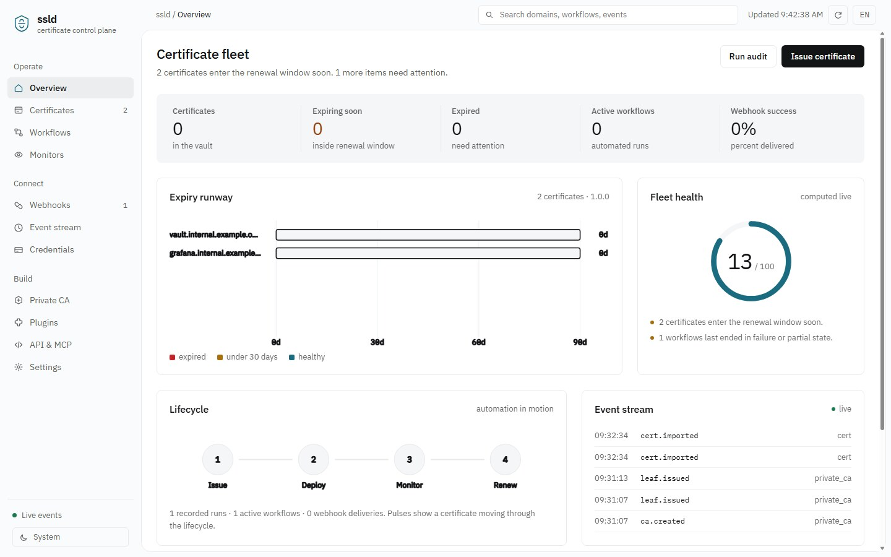

<details>
<summary>More screens (click to expand)</summary>

**Certificates** — the vault: every certificate parsed (SANs, issuer, chain, fingerprints), ordered by how soon it expires, with export / inspect / delete actions:

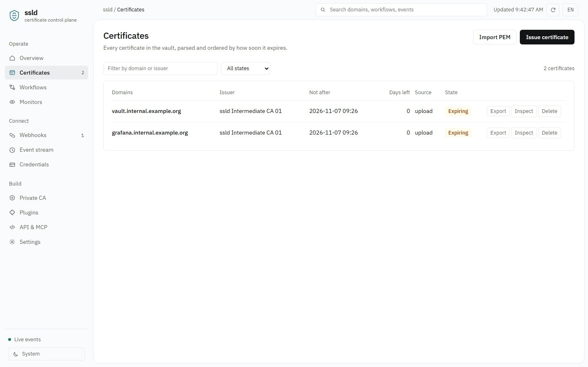

**Workflows** — reusable issue-deploy-notify pipelines with nested node trees, run history and per-node logs:

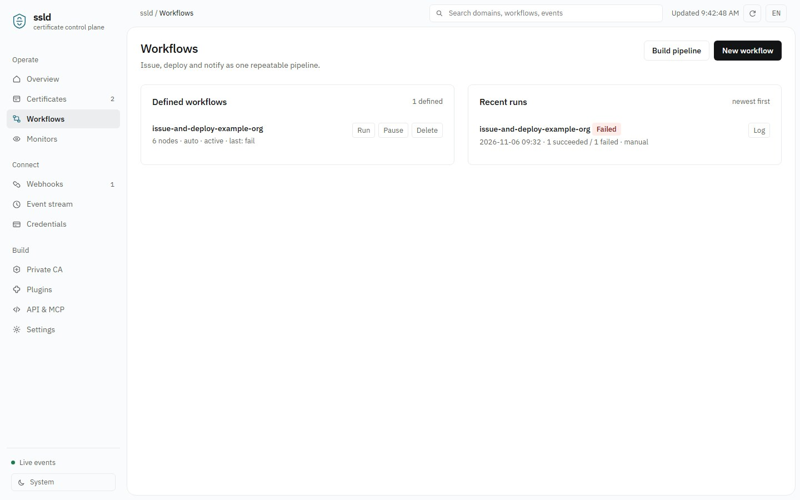

**Monitors** — HTTPS / SMTPS probes with expiry thresholds, error records and alert suppression:

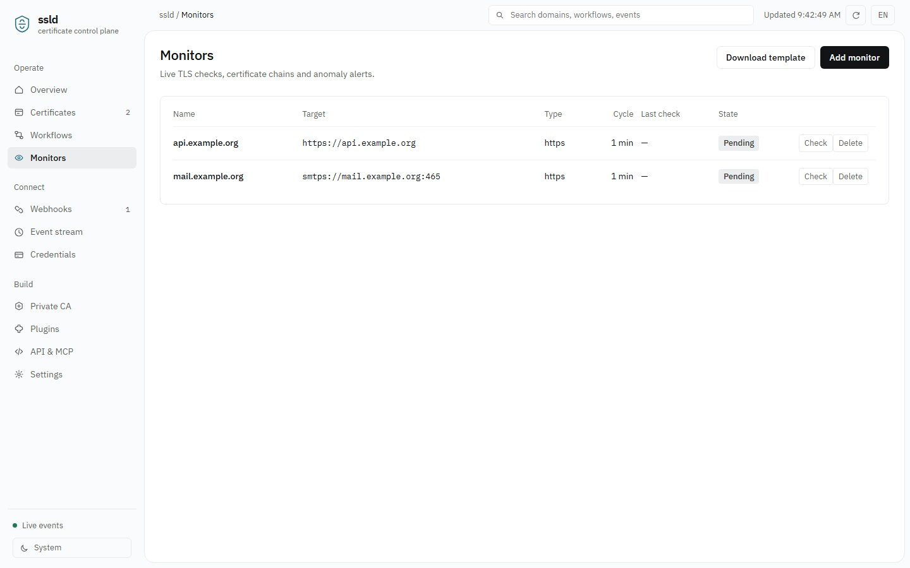

**Webhooks** — event subscriptions with wildcards, HMAC-SHA256 signing, retries, delivery ledger and replay:

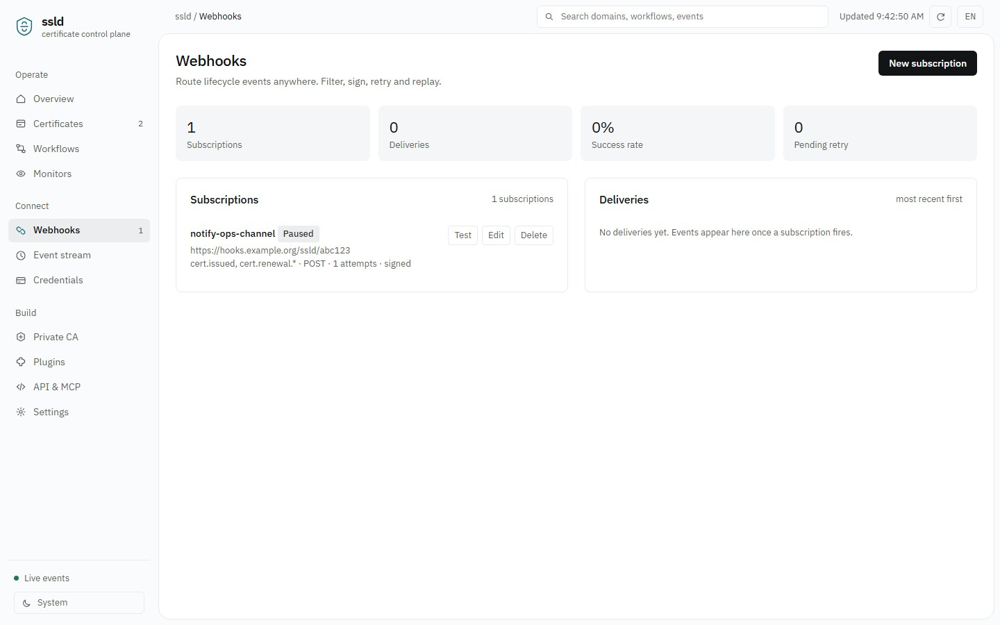

**Event stream** — every lifecycle event in order with its payload, live via server-sent events; the badge cloud is the full event vocabulary:

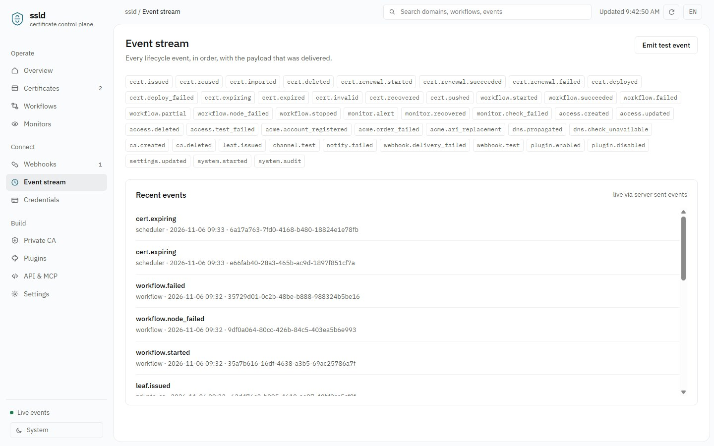

**Credentials** — DNS and host provider vaults (25 DNS providers, 32 deploy targets), connectivity tests and secret masking:

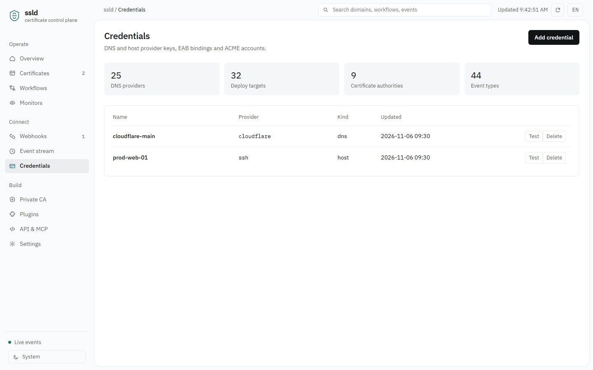

**Private CA** — Root → Intermediate → Leaf hierarchy with RSA / ECDSA / SM2, hierarchy constraints and guarded deletion:

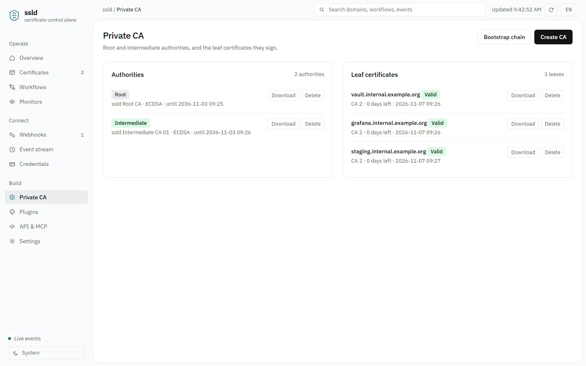

**API & MCP** — the complete REST surface, the 15 coarse-grained MCP tools, and copy-paste client configuration for AI agents:

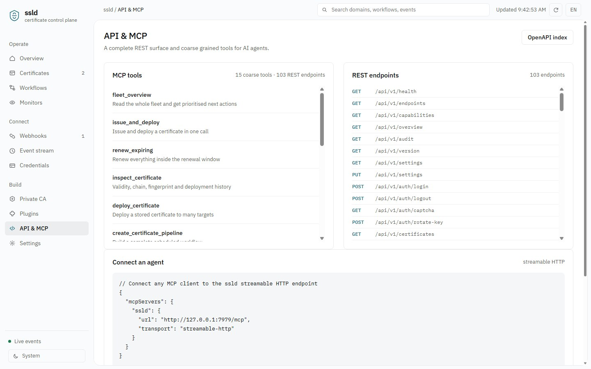

**Plugins** — module plugins (manifest scanning) and deploy plugins (stdin/stdout protocol):

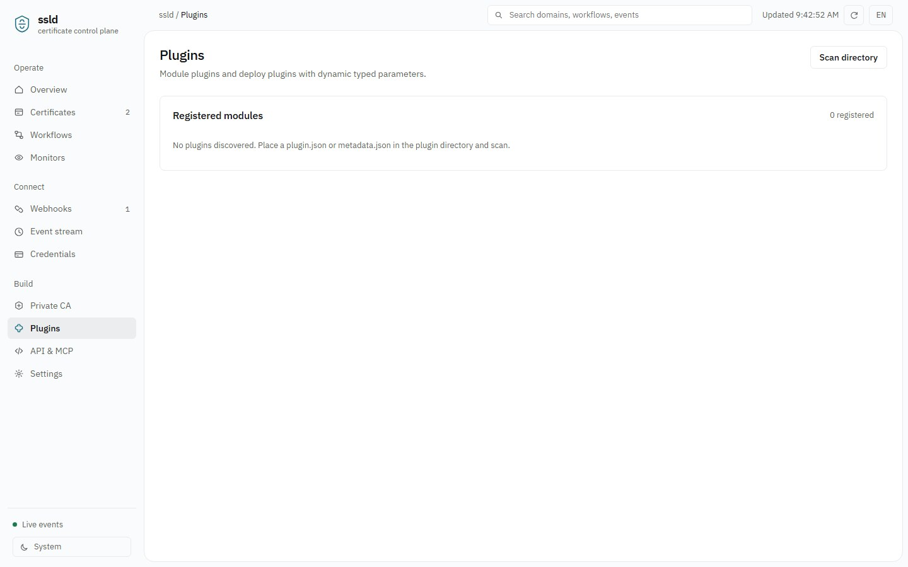

**Settings** — runtime preferences editable without a restart, notification channels and the open API key:

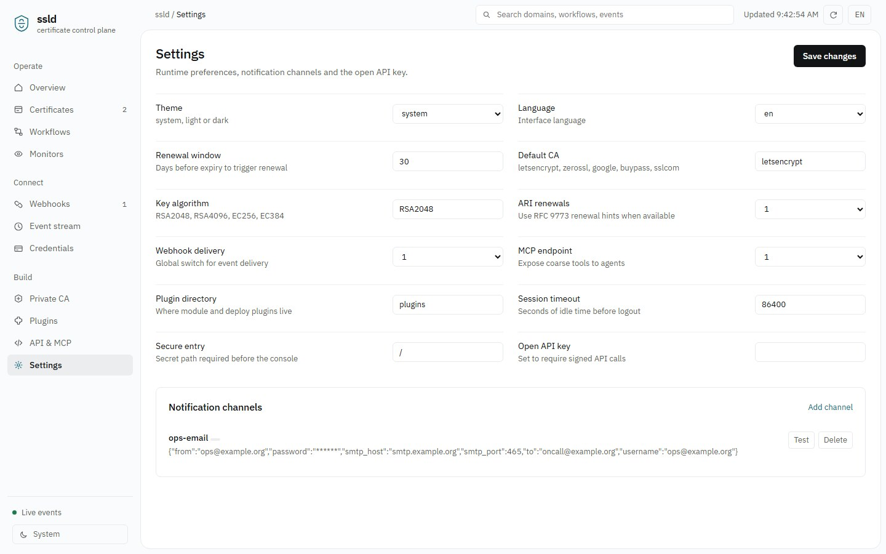

**Responsive** — the same console on tablet and phone:

<p>
  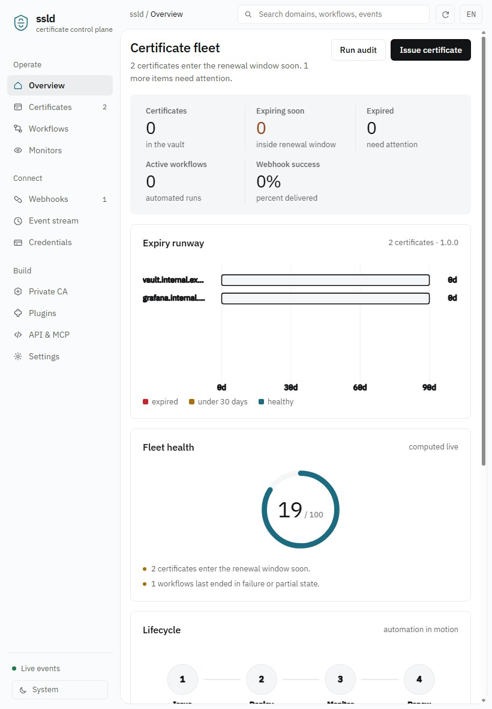
  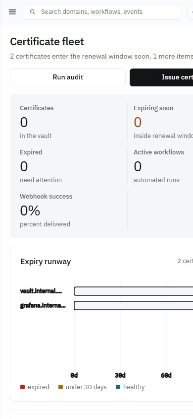
</p>

</details>

---

## Why ssld

- **Single-binary operations.** The web console is compiled into the binary via `include_str!`; deployment is one executable plus a data directory.
- **API-first.** Every capability is a REST endpoint. The MCP server, the webhook dispatcher and the web console all call the same service layer.
- **AI-assistant ready.** A coarse-grained MCP (Model Context Protocol) server exposes fleet-level operations (`fleet_overview`, `renew_expiring`, …) so AI agents can manage certificates without learning the low-level API.
- **Event-driven.** Every state change flows through one event funnel that feeds the audit log, an SSE stream and signed webhooks simultaneously.
- **Zero external runtime.** No SQLite, no PostgreSQL, no native C libraries. State is an atomically written JSON snapshot; swapping in a database backend only touches `store.rs`.
- **No CLI service-control surface.** Configuration lives in a JSON file, environment variables or the settings API. Process lifecycle (start/stop/restart) is delegated to your process manager — systemd, Docker, Supervisor, etc. Legacy CLI-control actions return `410 Gone`.

---

## Feature coverage

| Domain | What is implemented |
| --- | --- |
| ACME v2 (RFC 8555) | Hand-written client: directory discovery, nonce management, JWS (ES256) request signing, account registration with optional External Account Binding (EAB), `newOrder`, authorization polling, `finalize`, certificate-chain download, and RFC 9773 ARI (Automated Renewal Information) renewal hints with `replaces` |
| DNS-01 (RFC 8555 §8.4) | Native adapters for Cloudflare and acme-dns plus a generic webhook DNS provider; 20+ cloud vendors through a unified signed-HTTP layer (HMAC-SHA1 query signing, Alibaba TC3/HMAC-SHA256, AWS SigV4, Bearer, Basic, static API key); UDP TXT propagation verification (RFC 1035) against operator-configured authoritative nameservers, with CNAME delegation support |
| Certificate vault | Import from PEM/DER/PFX/JKS, X.509 parsing (SAN, chain, fingerprints, algorithms), issuance preview, re-use of still-valid certificates, expiry scanning, ZIP/PEM/DER export, external PFX/JKS conversion via `openssl`/`keytool`, bulk renewal |
| Deployment | 32 target kinds: localhost, SSH/SFTP, generic webhook, deploy plugins (stdin/stdout protocol), BT Panel, 1Panel, SafeLine, LeCDN, Tencent Cloud, Alibaba Cloud, Qiniu, Baidu Cloud, Huawei Cloud, Volcengine, Doge Cloud, RainYun and more; pre/post commands and idempotent skip when the target already holds the matching certificate |
| Credentials | DNS and host credential vaults, EAB key pairs, ACME account management, secret masking in list endpoints, connectivity tests, remote site listing, key rotation |
| Notifications | SMTP mail, generic webhook, DingTalk, Feishu (Lark), WeCom (WeChat Work); placeholder templating, DingTalk/Feishu signature authentication, multi-account alerting, test send |
| Workflows | Nested node trees (`child_node` chaining, `condition_nodes` parallel branches), sequential/parallel/condition/result branches, node input/output wiring, per-node run logs, manual and cron-like scheduled runs, one-call pipeline builder |
| Monitoring | HTTPS and SMTPS probes, remote certificate-chain parsing, expiry thresholds, error records, alert suppression windows, CSV/JSON bulk import with template |
| Private CA | Three-tier hierarchy (Root → Intermediate → Leaf); RSA, ECDSA and SM2 (SM2 dual signing/encryption certificates via external `openssl`, GM/T 0024 layout); hierarchy constraints (root cannot sign leaves directly, leaf validity bounded by intermediate, guarded deletion) |
| Plugins | Module plugins (protocol 1: `plugin.json`/`metadata.json` manifest scanning, enable/disable, action dispatch) and deploy plugins (stdin/stdout protocol) |
| System | Overview with recommended actions, security audit, operation audit log, backup/restore, OpenAPI 3.1 index, legacy gateway, login lockout, captcha, secure-entry path, HMAC API signing |
| Webhooks | Per-subscription event filters with `*` wildcards, HMAC-SHA256 signatures, custom headers and body templates, retries with exponential backoff, delivery ledger, test send, redelivery, statistics |
| Web console | Single-page dynamic console; one `requestAnimationFrame` clock drives KPI count-ups, expiry-runway scan, pipeline pulses, health-ring sweeps and live SSE events; light/dark theme following the system, bilingual UI (en/zh), responsive down to mobile, honors `prefers-reduced-motion` |

---

## Quick start

Requires Rust stable (edition 2021).

```bash
git clone https://github.com/liudonghua123/ssld.git
cd ssld
cargo build --release
./target/release/ssld        # Windows: target\release\ssld.exe
```

The server listens on `0.0.0.0:7979` by default and prints:

```
  Console   http://0.0.0.0:7979/
  REST API  http://0.0.0.0:7979/api/v1/health   (103 endpoints)
  MCP       http://0.0.0.0:7979/mcp            (15 coarse tools)
  Events    http://0.0.0.0:7979/api/v1/events/stream
  State     data/state.json
```

Local mode works out of the box: with no `SSLD_API_KEY` and no `SSLD_AUTH_REQUIRED`, the console and REST API are unauthenticated. **Before exposing it to a network, set `SSLD_API_KEY` or `SSLD_AUTH_REQUIRED=1`.**

```bash
# Production example: enable auth, change the port, relocate the data directory
SSLD_API_KEY='change-me' SSLD_PORT=9443 SSLD_DATA_DIR=/var/lib/ssld ./target/release/ssld

# Health check
curl http://127.0.0.1:7979/api/v1/health

# Call a high-level MCP tool directly
curl -s http://127.0.0.1:7979/mcp -H 'Content-Type: application/json' \
  -d '{"jsonrpc":"2.0","id":1,"method":"tools/call","params":{"name":"fleet_overview","arguments":{}}}'
```

The only startup flags are `--config`, `--port`, `--bind`, `--data-dir`, `--version` and `--help`. There are no service-control subcommands.

---

## Configuration

The config file defaults to `config/ssld.json` (built-in defaults apply when absent). See [`config/ssld.example.json`](config/ssld.example.json). Environment variables take precedence:

| Variable | Purpose | Default |
| --- | --- | --- |
| `SSLD_CONFIG` | Config file path | `config/ssld.json` |
| `SSLD_BIND` / `SSLD_PORT` | Listen address / port | `0.0.0.0` / `7979` |
| `SSLD_DATA_DIR` | State directory | `data` |
| `SSLD_API_KEY` | Static API key; setting it forces authentication | empty |
| `SSLD_AUTH_REQUIRED` | Set to `1` to force authentication | off |
| `SSLD_ADMIN_USER` / `SSLD_ADMIN_PASSWORD` | Console admin | `admin` / `ssld` |
| `SSLD_SECURE_ENTRY` | Secure entry path | `/` (disabled) |
| `SSLD_HTTPS` | Serve HTTPS with `tls_cert` / `tls_key` from config | off |
| `SSLD_WEBHOOK_SECRET` / `SSLD_WEBHOOK_OFF` | Default signing secret / disable dispatch | empty / on |
| `SSLD_MCP_PATH` | MCP endpoint path | `/mcp` |
| `SSLD_TICK_SECONDS` / `SSLD_SCHEDULER_OFF` | Scheduler tick / disable scheduler | `10` / on |

Settings can also be changed at runtime through `PUT /api/v1/settings`, with no restart. `config/ssld.json` and everything under `data/` (state, logs, certificate private keys) are ignored by Git. Copy the example file locally and never commit real credentials.

### Authentication

- **Local mode** (default): no API key and auth not forced, so it just works on a trusted host.
- **Bearer / Cookie session**: `POST /api/v1/auth/login` returns a token and sets the `ssld_session` cookie.
- **HMAC API signing** (gateway requests): pass `api_token` + `timestamp`, computed as either `sha256(timestamp + sha256(api_key))` or `base64(HMAC-SHA256(api_key, timestamp + "." + sha256(api_key)))`, with a 300-second validity window and constant-time comparison.

---

## Documentation

| Document | Contents |
| --- | --- |
| [docs/API.md](docs/API.md) | All 103 REST endpoints by group, response envelope, gateway, auth |
| [docs/MCP.md](docs/MCP.md) | 15 high-level MCP tools, resources, JSON-RPC examples, client setup |
| [docs/WEBHOOKS.md](docs/WEBHOOKS.md) | Subscription fields, events and wildcards, signature verification, templates, retries, redelivery, stats |
| [docs/ARCHITECTURE.md](docs/ARCHITECTURE.md) | Module map, data model, ACME flow, workflows and scheduling, storage, security boundary |
| [readme-zh_CN.md](readme-zh_CN.md) | 简体中文说明 |
| [tests/smoke.js](tests/smoke.js) | End-to-end smoke test (38 checks) |

---

## Verification

Completed on Windows / Rust stable / MSVC:

- `cargo check`, `cargo build`: **0 errors, 0 warnings**.
- Front-end design gates (external design-review scripts, not shipped in this repo): static lint **0 FAIL**; viewport checks at 1440 / 768 / 390 **0 FAIL, 0 WARN**.
- `node tests/smoke.js [port]`: **38 / 38 passing** on a fresh empty state using the example config, covering service and static assets, three-tier private CA and its constraints, certificate import and SANs, ZIP export, pipeline build and execution, monitor bulk import, gateway compatibility, `410 Gone` for CLI-control actions, webhooks and the event vocabulary, audit, backup/restore, the MCP tool list and 5 high-level tools.
- Webhook suite: signatures byte-compared against `crypto.createHmac` (VALID), event filtering, custom headers, template rendering, delivery ledger, test send, redelivery, statistics and live SSE broadcast all passed.

### Known boundaries

- State is one atomically written JSON snapshot rather than a database. This suits a single node and moderate fleet sizes; very large or multi-node deployments should swap in a database backend (the seam is `store.rs` only).
- `openssl` / `keytool` are invoked on demand only for PFX / JKS / SM2 dual-certificate conversion; the core is pure Rust.
- Only the DNS-01 challenge is implemented; HTTP-01, TLS-ALPN-01 and custom CSR flows are out of scope.
- Issuing certificates from public CAs requires valid DNS credentials and network access to the ACME directory. The smoke test uses private-CA-issued certificates and never places a real ACME order.

---

## License

[MIT](LICENSE)
