# ssld

**自托管的 SSL/TLS 证书全生命周期控制平面，纯 Rust 实现。**

ssld 将 TLS 证书的完整生命周期 —— ACME 注册、DNS-01 验证、签发、入库、部署、续期、监控与告警 —— 收拢到一个内嵌 Web 控制台的单体静态二进制中。运行时不需要任何外部数据库，除操作系统外没有其他依赖。

仓库：<https://github.com/liudonghua123/ssld> · [English](README.md) · [MIT 协议](LICENSE)

| 指标 | 数值 |
| --- | --- |
| REST 端点 | 103（内置 OpenAPI 3.1 索引） |
| MCP 高层工具 | 15（JSON-RPC 2.0，streamable HTTP） |
| 兼容 `/v1/{group}/{action}` 网关动作 | 71 |
| DNS 服务商 / 主机凭据 / 部署目标 | 25 / 18 / 32 |
| CA / 密钥算法 / 通知渠道 / 事件类型 | 9 / 6 / 5 / 44 |
| 工作流节点类型 / 导出格式 | 12 / 5 |
| 运行时依赖 | 无 —— JSON 快照持久化，零原生库 |

## 控制台一览

概览仪表盘 —— 证书舰队 KPI、到期跑道、舰队健康分、生命周期流水线与实时事件流，全部由单一动画时钟驱动：

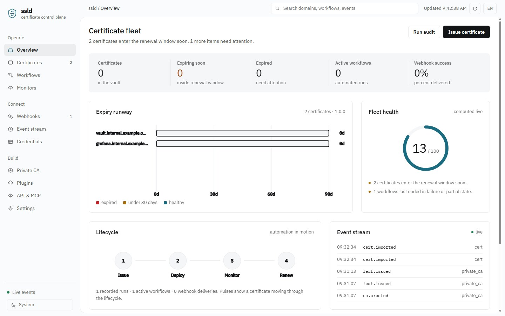

<details>
<summary>更多页面（点击展开）</summary>

**证书仓库** —— 全部证书解析入库（SAN、签发者、证书链、指纹），按到期时间排序，支持导出 / 检视 / 删除：

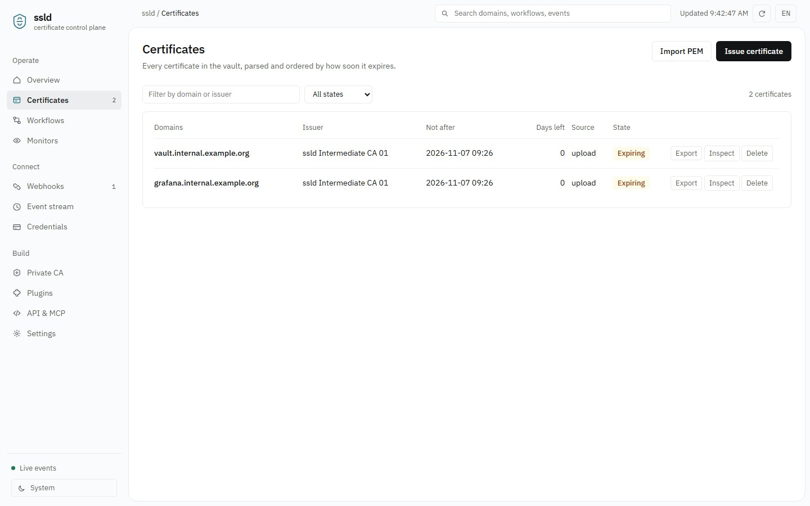

**工作流** —— 可复用的「签发-部署-通知」流水线，嵌套节点树、运行历史与逐节点日志：

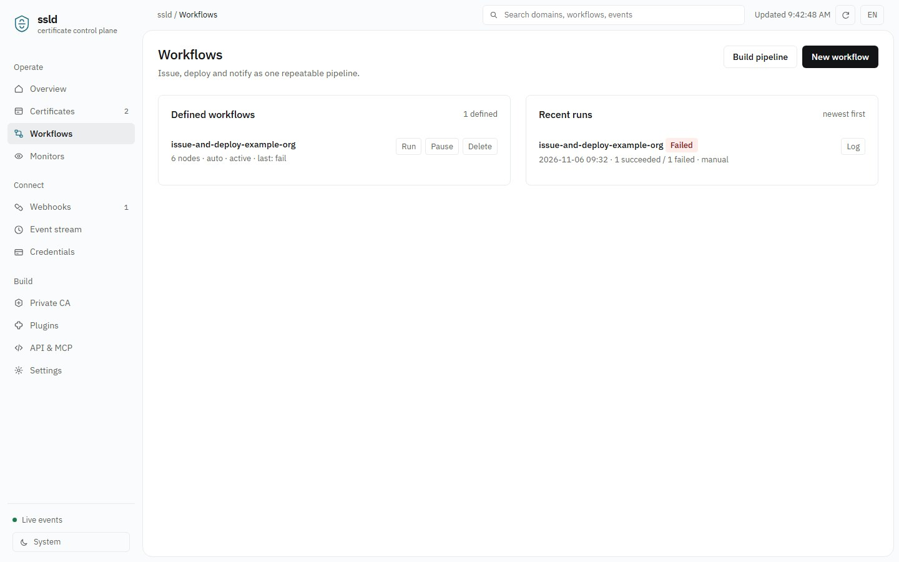

**监控** —— HTTPS / SMTPS 探测、过期阈值、异常记录与告警抑制：

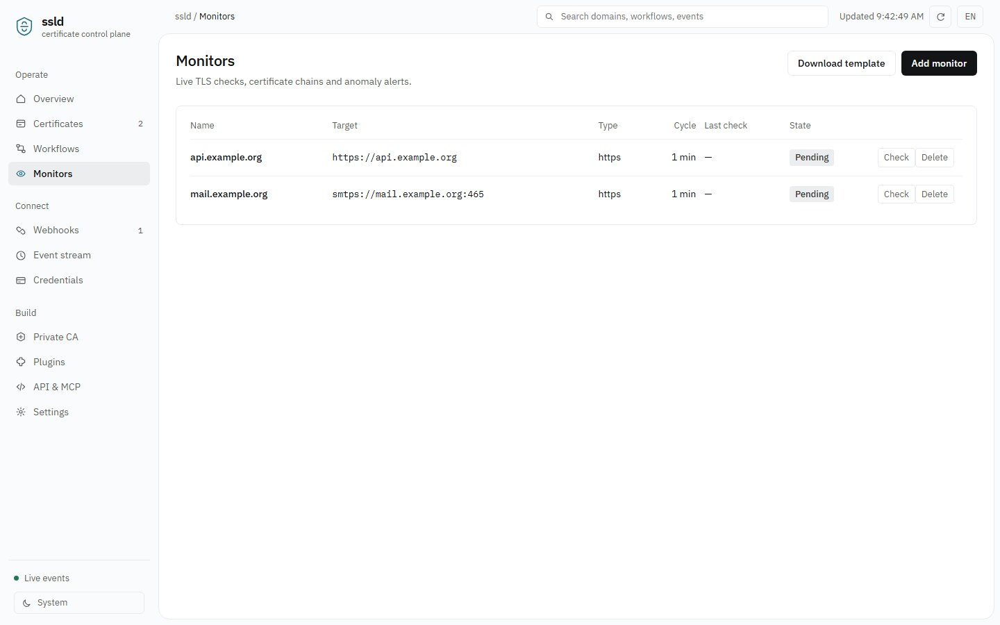

**Webhook** —— 事件订阅，支持通配符、HMAC-SHA256 签名、重试、投递台账与重放：

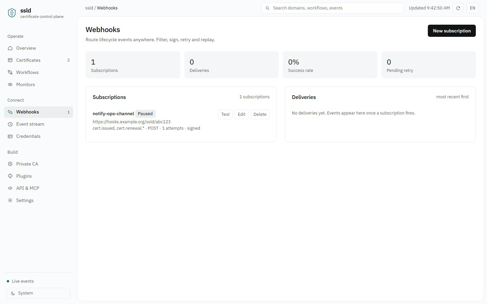

**事件流** —— 全部生命周期事件按序展示并附带载荷，经 SSE 实时推送；徽章云为完整事件词表：

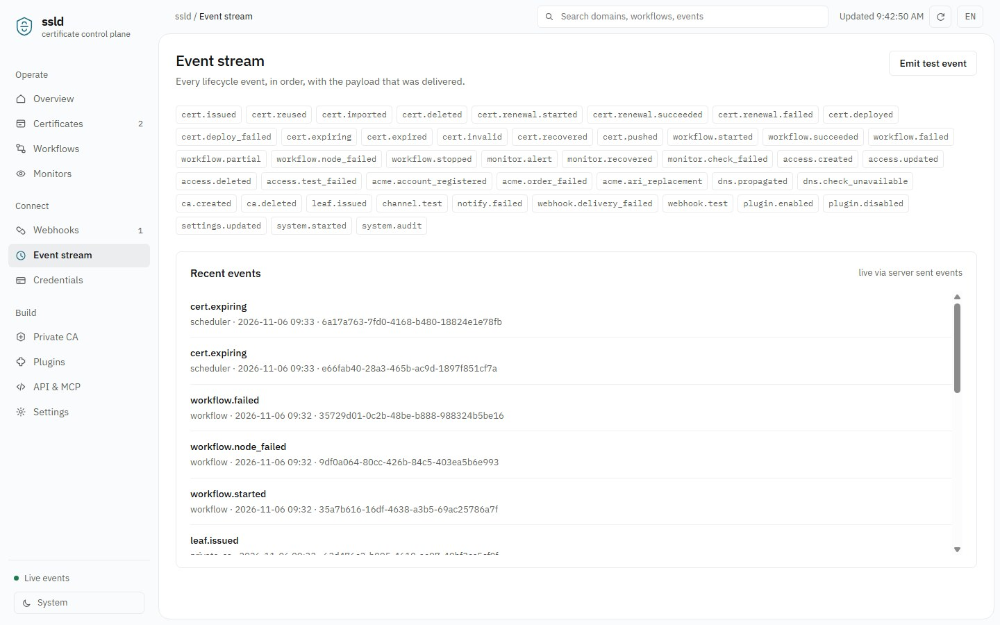

**凭据** —— DNS 与主机凭据库（25 家 DNS 服务商、32 类部署目标）、连通性测试与密钥脱敏：

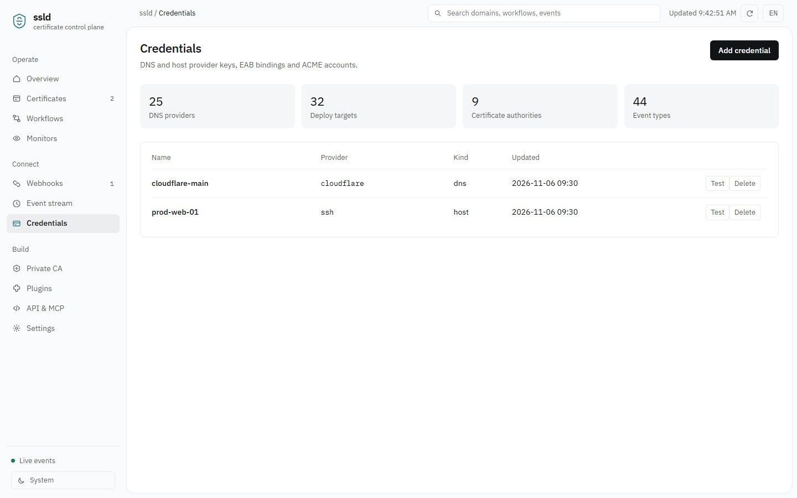

**私有 CA** —— Root → Intermediate → Leaf 三级层级，支持 RSA / ECDSA / SM2，带层级约束与删除保护：

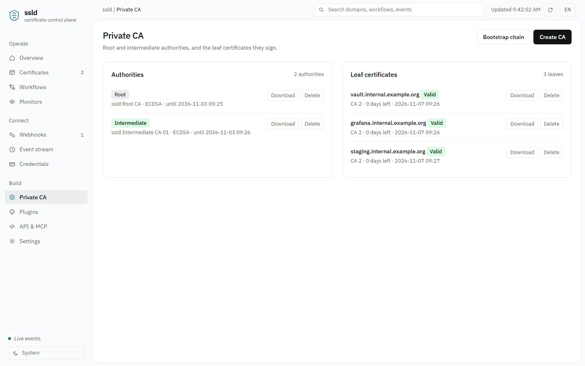

**API & MCP** —— 完整 REST 端点面、15 个粗粒度 MCP 工具，以及可直接复制的 AI 智能体接入配置：

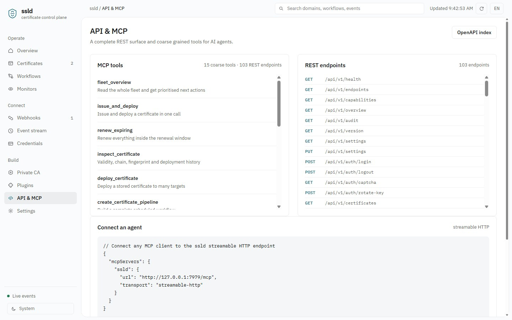

**插件** —— 模块插件（清单扫描）与部署插件（stdin/stdout 协议）：

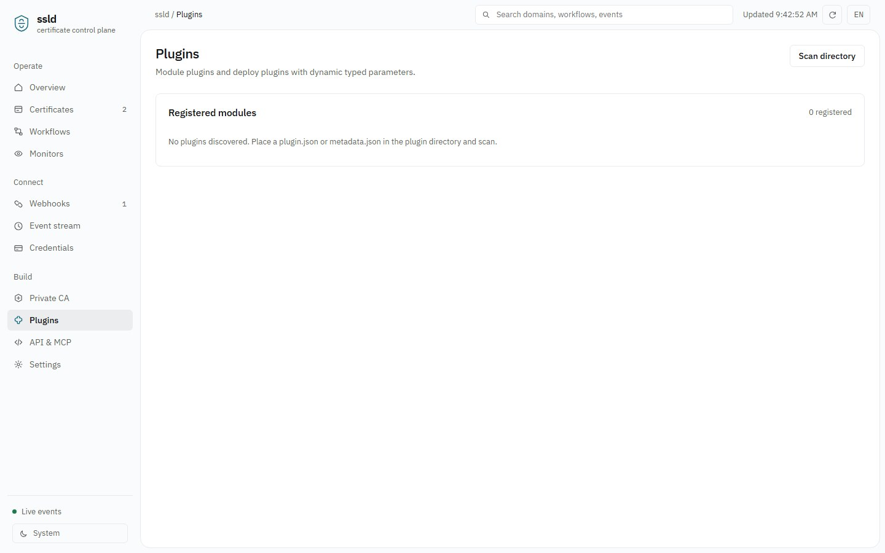

**设置** —— 运行时偏好免重启修改、通知渠道与开放 API 密钥：

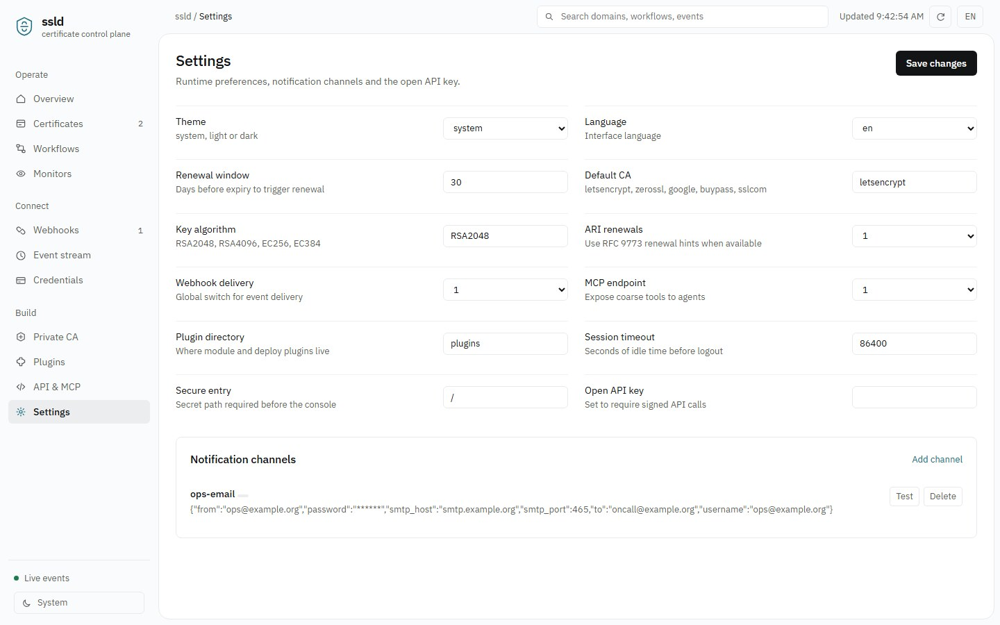

**响应式** —— 同一控制台在平板与手机上：

<p>
  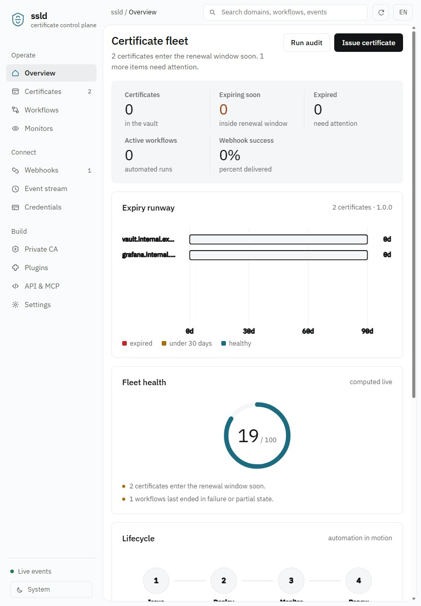
  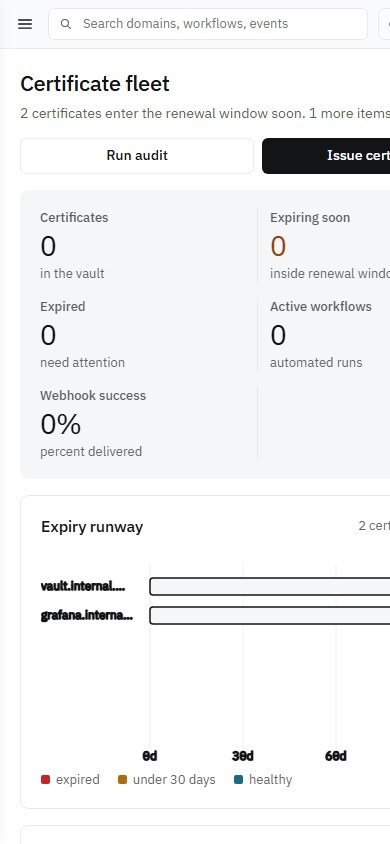
</p>

</details>

---

## 设计取向

- **单二进制运维。** Web 控制台通过 `include_str!` 编译进二进制，部署产物是一个可执行文件加一个数据目录。
- **API 优先。** 每个能力都是一条 REST 端点；MCP 服务、Webhook 分发器与 Web 控制台共用同一服务层。
- **面向 AI 助手。** 粗粒度的 MCP（Model Context Protocol）服务暴露舰队级操作（`fleet_overview`、`renew_expiring` 等），AI 智能体无需学习底层 API 即可管理证书。
- **事件驱动。** 所有状态变化经由单一事件漏斗，同时写入审计日志、SSE 实时流与带签名的 Webhook。
- **零外部运行时。** 不需要 SQLite、PostgreSQL 或任何原生 C 库。状态为原子写入的 JSON 快照；替换为数据库后端只需改动 `store.rs`。
- **无 CLI 服务控制面。** 配置只存在于 JSON 文件、环境变量或设置 API；进程的启停与重启交给进程管理器（systemd / Docker / Supervisor 等），旧式 CLI 控制动作一律返回 `410 Gone`。

---

## 功能覆盖

| 领域 | 实现内容 |
| --- | --- |
| ACME v2（RFC 8555） | 手写客户端：目录发现、nonce 管理、JWS（ES256）请求签名、带可选 External Account Binding（EAB）的账户注册、`newOrder`、authorization 轮询、`finalize`、证书链下载，以及 RFC 9773 ARI（Automated Renewal Information）续期提示与 `replaces` |
| DNS-01（RFC 8555 §8.4） | Cloudflare 与 acme-dns 原生适配器及通用 Webhook DNS；20 余家云厂商走统一签名 HTTP 层（HMAC-SHA1 查询签名、阿里云 TC3/HMAC-SHA256、AWS SigV4、Bearer、Basic、静态 API Key）；对运维配置的权威 nameserver 做 UDP TXT 传播校验（RFC 1035），支持 CNAME 委派 |
| 证书仓库 | PEM/DER/PFX/JKS 导入，X.509 解析（SAN、证书链、指纹、算法），签发预览，仍有效证书复用，过期扫描，ZIP/PEM/DER 导出，经 `openssl`/`keytool` 的 PFX/JKS 外部转换，批量续期 |
| 部署 | 32 类目标：localhost、SSH/SFTP、通用 Webhook、部署插件（stdin/stdout 协议）、宝塔面板、1Panel、SafeLine、LeCDN、腾讯云、阿里云、七牛、百度云、华为云、火山引擎、多吉云、RainYun 等；支持前置/后置命令与目标已持有同证书时的幂等跳过 |
| 凭据 | DNS 与主机凭据库、EAB 密钥对、ACME 账户管理、列表接口密钥脱敏、连通性测试、远端站点列表、密钥轮换 |
| 通知 | SMTP 邮件、通用 Webhook、钉钉、飞书（Lark）、企业微信（WeCom）；占位符模板、钉钉/飞书签名鉴权、多账号告警、测试发送 |
| 工作流 | 嵌套节点树（`child_node` 串接、`condition_nodes` 并行分支）、顺序/并行/条件/结果分支、节点输入输出接线、逐节点运行日志、手动与类 cron 计划执行、一次调用生成证书流水线 |
| 监控 | HTTPS 与 SMTPS 探测、远端证书链解析、过期阈值、异常记录、告警抑制窗口、CSV/JSON 批量导入与模板 |
| 私有 CA | 三级层级（Root → Intermediate → Leaf）；RSA、ECDSA 与 SM2（SM2 签名/加密双证书经外部 `openssl`，GM/T 0024 布局）；层级约束（root 禁止直签 leaf、leaf 有效期不得超过 intermediate、删除保护） |
| 插件 | 模块插件（协议 1：`plugin.json`/`metadata.json` 清单扫描、启停、动作分发）与部署插件（stdin/stdout 协议） |
| 系统 | 概览与推荐动作、安全审计、操作审计日志、备份恢复、OpenAPI 3.1 索引、旧版网关、登录锁定、验证码、安全入口路径、HMAC API 签名 |
| Webhook | 按订阅的事件过滤与 `*` 通配符、HMAC-SHA256 签名、自定义 header 与 body 模板、指数退避重试、投递台账、测试发送、重放、统计 |
| Web 控制台 | 单页动态控制台；单一 `requestAnimationFrame` 时钟驱动 KPI 计数、到期跑道扫描、流水线脉冲、健康环扫过与 SSE 实时事件；浅/深色主题跟随系统、界面中英双语、响应式适配移动端、尊重 `prefers-reduced-motion` |

---

## 快速开始

需要 Rust stable（edition 2021）。

```bash
git clone https://github.com/liudonghua123/ssld.git
cd ssld
cargo build --release
./target/release/ssld        # Windows：target\release\ssld.exe
```

服务默认监听 `0.0.0.0:7979`，启动后终端会打印：

```
  Console   http://0.0.0.0:7979/
  REST API  http://0.0.0.0:7979/api/v1/health   (103 endpoints)
  MCP       http://0.0.0.0:7979/mcp            (15 coarse tools)
  Events    http://0.0.0.0:7979/api/v1/events/stream
  State     data/state.json
```

本地开箱即用：未设置 `SSLD_API_KEY` 且未显式开启 `SSLD_AUTH_REQUIRED` 时，控制台与 REST API 不强制鉴权。**部署到网络环境前必须设置 `SSLD_API_KEY` 或 `SSLD_AUTH_REQUIRED=1`。**

```bash
# 生产示例：开启鉴权、改端口、迁移数据目录
SSLD_API_KEY='change-me' SSLD_PORT=9443 SSLD_DATA_DIR=/var/lib/ssld ./target/release/ssld

# 健康检查
curl http://127.0.0.1:7979/api/v1/health

# 直接调用 MCP 高层工具
curl -s http://127.0.0.1:7979/mcp -H 'Content-Type: application/json' \
  -d '{"jsonrpc":"2.0","id":1,"method":"tools/call","params":{"name":"fleet_overview","arguments":{}}}'
```

启动参数只有 `--config` / `--port` / `--bind` / `--data-dir` / `--version` / `--help`，没有任何服务控制子命令。

---

## 配置

配置文件默认为 `config/ssld.json`（不存在时使用内置默认值），完整示例见 [`config/ssld.example.json`](config/ssld.example.json)。环境变量优先级最高：

| 变量 | 说明 | 默认 |
| --- | --- | --- |
| `SSLD_CONFIG` | 配置文件路径 | `config/ssld.json` |
| `SSLD_BIND` / `SSLD_PORT` | 监听地址 / 端口 | `0.0.0.0` / `7979` |
| `SSLD_DATA_DIR` | 状态目录 | `data` |
| `SSLD_API_KEY` | 静态 API 密钥，设置后自动强制鉴权 | 空 |
| `SSLD_AUTH_REQUIRED` | 设为 `1` 强制鉴权 | 关 |
| `SSLD_ADMIN_USER` / `SSLD_ADMIN_PASSWORD` | 控制台管理员 | `admin` / `ssld` |
| `SSLD_SECURE_ENTRY` | 安全入口路径 | `/`（关闭） |
| `SSLD_HTTPS` | 启用 HTTPS（配合配置中的 `tls_cert` / `tls_key`） | 关 |
| `SSLD_WEBHOOK_SECRET` / `SSLD_WEBHOOK_OFF` | 默认 Webhook 签名密钥 / 关闭分发 | 空 / 开 |
| `SSLD_MCP_PATH` | MCP 端点路径 | `/mcp` |
| `SSLD_TICK_SECONDS` / `SSLD_SCHEDULER_OFF` | 调度 tick / 关闭调度器 | `10` / 开 |

运行时也可以通过 `PUT /api/v1/settings` 修改设置，无需重启。`config/ssld.json` 与 `data/` 下的状态、日志、证书私钥均已被 Git 忽略；请从示例文件复制后本地填写，不要提交真实凭据。

### 鉴权方式

- **本地模式**（默认）：无 API key 且不强制鉴权，适用于可信主机。
- **Bearer / Cookie 会话**：`POST /api/v1/auth/login` 返回 token 并下发 `ssld_session` Cookie。
- **HMAC API 签名**（网关请求）：携带 `api_token` 与 `timestamp`，支持两种算法：`sha256(timestamp + sha256(api_key))`，或 `base64(HMAC-SHA256(api_key, timestamp + "." + sha256(api_key)))`；带 300 秒时间窗与常量时间比较。

---

## 文档

| 文档 | 内容 |
| --- | --- |
| [docs/API.md](docs/API.md) | 103 个 REST 端点分组参考、统一响应封装、兼容网关、鉴权 |
| [docs/MCP.md](docs/MCP.md) | 15 个 MCP 高层工具、资源、JSON-RPC 调用示例与接入方式 |
| [docs/WEBHOOKS.md](docs/WEBHOOKS.md) | 订阅字段、事件与通配符、签名校验、模板、重试、重放与统计 |
| [docs/ARCHITECTURE.md](docs/ARCHITECTURE.md) | 模块地图、数据模型、ACME 流程、工作流与调度、存储与安全边界 |
| [README.md](README.md) | English README |
| [tests/smoke.js](tests/smoke.js) | 端到端冒烟测试（38 项检查） |

---

## 验证结果

在 Windows / Rust stable / MSVC 上完成：

- `cargo check`、`cargo build`：**0 error、0 warning**。
- 前端设计检查（仓库外的设计评审脚本，不随源码分发）：静态规范检查 **0 FAIL**；1440 / 768 / 390 三档视口检查 **0 FAIL、0 WARN**。
- 端到端冒烟测试 `node tests/smoke.js [port]`：**38 / 38 通过**（在全新空状态与示例配置下运行），覆盖服务与静态资源、私有 CA 三级层级与约束、证书导入与 SAN、ZIP 导出、流水线构建与执行、监控批量导入、网关兼容性、CLI 控制动作返回 `410 Gone`、Webhook 与事件词表、审计与备份恢复、MCP 工具列表及 5 个高层工具。
- Webhook 专项：签名与 `crypto.createHmac` 逐字节比对（VALID）、事件过滤、自定义 header、模板渲染、投递台账、测试发送、重放、统计、SSE 实时广播全部通过。

### 已知边界

- 状态持久化采用单文件 JSON 原子快照而非数据库，适合单机与中等规模舰队；超大规模或多节点部署应替换为数据库后端（只需改动 `store.rs`）。
- `openssl` / `keytool` 仅在 PFX / JKS / SM2 双证书转换时按需调用；主体逻辑为纯 Rust。
- 仅实现 DNS-01 质询；HTTP-01、TLS-ALPN-01 与自定义 CSR 流程不在范围内。
- 向公共 CA 申请证书需要有效的 DNS 凭据与可达的 ACME 目录；冒烟测试使用私有 CA 签发的证书，不会触发真实 ACME 下单。

---

## 许可证

[MIT](LICENSE)
